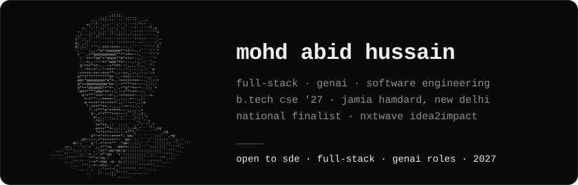
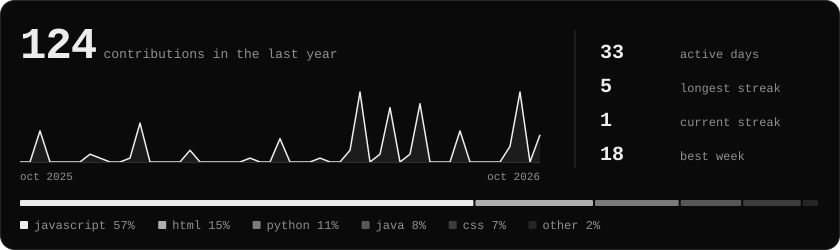

[email](mailto:abidhussain.m47@gmail.com) · [linkedin](https://www.linkedin.com/in/mohd-abid-hussain) · [x](https://x.com/md_abid_13)

### about

Final-year B.Tech CSE student at Jamia Hamdard, New Delhi, graduating in 2027. I build full-stack web apps with GenAI features: React and Node for the product, LLM APIs for the intelligence. I deploy what I build and practise DSA in Java.

Looking for **Associate Software Engineer / SDE, full-stack and GenAI roles**, from 2027 or as an internship from 2026.

### stack

```
languages     java · javascript · python · sql
frontend      react · html · css · tailwind · bootstrap
backend       node · express · rest apis · jwt auth
databases     mongodb · mysql · sqlite
genai         llm apis (gemini) · prompt engineering · rag
tools         git · github actions · vercel · render
fundamentals  dsa (java) · oop · dbms · os · computer networks
```

### projects

**[gramsetu ai](https://github.com/md-abidhussain/GramSetu)** · national finalist, nxtwave idea2impact · lead developer, team of 3\
A GovTech platform where citizens, inspectors and officials audit public infrastructure work. Photo evidence goes through two checks: Gemini Vision for context, and a YOLOv8 segmentation model that measures potholes and cracks in cm². Role-based access with JWT, contractor trust scores, and map dashboards.\
`react` `node` `express` `mongodb` `jwt` `gemini` · [live](https://gramsetu-india.vercel.app)

**[loanlens ai](https://github.com/md-abidhussain/LoanLensAI)** · ai hackathon 2026\
Upload a loan agreement as a PDF or image. It extracts the text, flags risky clauses, estimates the effective APR, scores the loan's health and suggests what to negotiate. Gemini returns schema-validated JSON, and past scans are stored in SQLite.\
`node` `express` `sqlite` `gemini` `rest api` · [live](https://loanlens-ai.onrender.com)

**[ai interview coach](https://github.com/md-abidhussain/AI-Interview-Coach)** · edunet × microsoft internship project\
Mock interviews for any role. Answer by typing, uploading audio or speaking live. Whisper transcribes, and Gemini scores the answer out of 10 with structured feedback. bcrypt-hashed logins in SQLite.\
`python` `streamlit` `gemini` `whisper` `sqlite` · [live](https://ai-interview-coach-6122005.streamlit.app)

**[donorx](https://github.com/md-abidhussain/donorx)** · technozova 6.0, 24-hour hackathon\
A blood-donor request board that ranks requests by urgency, expires them automatically, and uses rule-based checks to hold back fake posts.\
`javascript` `bootstrap` · [live](https://md-abidhussain.github.io/donorx/)

<sub>The Render-hosted demos sleep when idle, so the first load can take about a minute.</sub>

### experience

**AI Engineer Intern** · Coding Blocks School of Technology · Jun – Jul 2026\
Gen AI track. Projects: telecom customer-churn prediction, and an AI research-analysis assistant built both with and without an agent.

**AI Azure Intern** · Edunet Foundation × Microsoft × AICTE · Jun – Jul 2025\
4-week AI on Azure program. Final project: AI Interview Coach.

### activity



<sub>A <a href="scripts/generate.mjs">small Node script</a> draws the graphics on this page from the GitHub GraphQL API, and a <a href=".github/workflows/profile.yml">GitHub Action</a> refreshes them every night. The portrait is my photo, converted to ASCII by the same script. No third-party stat services.</sub>
